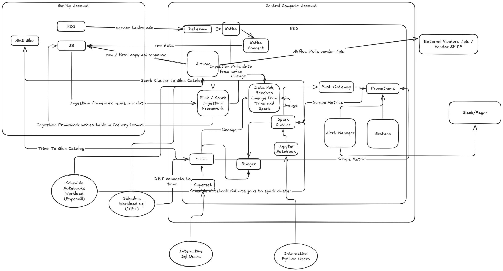

# Lakehouse Data Platform Design Document v3

## Architecture Diagram

## 1. Platform Infrastructure & Environment
### Multi-Tenant Deployment & IaaC
To support strict compliance and regulatory guidelines across lending, insurance, and recharge businesses, the platform uses a multi-tenant environment. Each entity is completely isolated at the storage level, meaning data always resides in entity-specific AWS accounts. However, compute resources are shared centrally across entities. This shared compute model saves significant operational and infrastructure overhead while adhering to data residency requirements. All infrastructure and roles are deployed via Infrastructure as Code (IaaC) using Terraform, with Helm charts managing the Kubernetes (EKS) clusters.

### Cloud-Native Open-Source Stack
The platform uses self-managed, open-source technologies deployed on the cloud. While SaaS solutions like Databricks or Snowflake offer simplicity, a self-managed open-source stack significantly minimizes costs, provides absolute flexibility, and avoids vendor lock-in.

## 2. Data Storage & Table Format
### Medallion Architecture (Bronze, Silver, Gold)
*   **Bronze (Raw/0th Copy):** Contains the immutable raw data exactly as it arrives from sources.
*   **Silver (Cleaned/Trustworthy):** Contains deduplicated, typed, and DQ-validated data. This layer acts as the single source of truth.
*   **Gold (Analytics/Served):** Contains business-level aggregates, feature stores, and campaign targeting tables created by domain experts.

### Apache Iceberg
The core storage format is Apache Iceberg on Amazon S3. Iceberg was chosen over Delta and Hudi for several reasons:
*   **Upsert Performance:** Its Merge-On-Read mechanism (specifically Equality Deletes in v2) provides excellent performance for high-frequency CDC data.
*   **Ecosystem Support:** It enjoys strong recent support from the community and different vendors, integrating seamlessly across Trino, Athena, and Spark. (While Athena can read Delta, it struggles with writes; Hudi is highly capable but too operationally complex to manage).

## 3. Data Ingestion Component
### The "Narrow Waist" Abstraction
To avoid managing dozens of bespoke pipelines, the ingestion framework abstracts the entry points. Upstream sources must dump their data exclusively into S3 or Kafka. The ingestion framework acts as a gateway, strictly reading from S3 or Kafka and writing to Iceberg. This abstraction reduces the burden of managing disparate codebases.
*   **Sources:** RDS databases use AWS DMS or Debezium (via Kafka Connect) to dump CDC streams to Kafka or S3. Third-party APIs and vendor files are polled via Airflow DAGs and dumped directly to S3. 

### Real-Time vs. Batch (Dual-Engine Framework)
The platform supports both batch and streaming to balance cost and SLA requirements:
*   **Apache Spark:** Used for the majority of batch workloads due to its flexibility, lower learning curve, and ease of management.
*   **Apache Flink:** Spark micro-batching is insufficient for true event-to-event processing with very low latency. For these strict real-time requirements, the platform utilizes Flink.

### Efficient File Discovery & Checkpointing
Listing S3 directories to find new files is a slow, expensive, and choking operation. The framework uses custom checkpointing to avoid this:
*   **SQS Notifications:** S3 triggers an event to an SQS queue upon file arrival, which the framework polls.
*   **S3 StartAfter:** If file drops agree on a contract to be lexicographically sorted, the framework uses the `ListObjects(StartAfter)` API to read only newly appended files.

### Schema Evolution via Branching
Iceberg's branching support (WAP - Write, Audit, Publish) is utilized for schema evolution. A new batch is merged into an isolated test branch to verify schema compatibility. If successful, the branch is merged into the main table.

## 4. Governance & Security Component
### Apache Ranger Integration
Security and governance are centrally managed by Apache Ranger. Ranger provides fine-grained, centralized policy management.
*   **Access Control Lists (ACLs):** Access is granted based on Line of Business (LOB) teams (e.g., `lending-ops`, `lending-analytics`). 
*   **Column-Level Security & Masking:** PII is strictly governed. For example, `lending-ops` may be granted access to plaintext mobile numbers for operational duties, while analysts only see hashed values or user IDs.

### Data Sharing as a Contract
When a table needs to be shared across teams, the owner creates a View in a shared schema rather than rewriting the data. This saves storage and compute costs. The View acts as a strict data contract: the owner can manipulate the underlying table, but the view's schema must remain intact to prevent downstream breakage.

## 5. Serving & Orchestration Component
### Interactive Querying
*   **Analysts & BI:** Superset is connected to a **Trino** cluster. Trino was explicitly selected over Spark for the query layer because of its superior native integration with Apache Ranger and its secure handling of Views.
*   **Data Science:** Python users access data via Jupyter Hub connected to a Spark cluster using Livy or Spark Connect.
Every query executed through Trino or Spark dynamically checks Ranger ACLs before data is returned.

### Scheduled Workloads
Apache Airflow serves as the central orchestrator:
*   **SQL Workloads:** Airflow triggers `dbt`, which executes transformations on Trino.
*   **Data Science Workloads:** Airflow submits Python scripts or notebooks to the Spark cluster, managing complex dependencies.

## 6. Observability, Lineage & Monitoring Component
### Metadata & Lineage
Achieving 100% data lineage across open-source tools is challenging. The platform deploys **OpenLineage** on the Spark and Trino clusters to emit lineage events. These events are captured by **DataHub**, providing operational confidence into downstream data usage and impact analysis. Custom utilities further enforce lineage capture by wrapping query execution.

### Metrics & Alerting
*   **Scraping & Storage:** EKS, Flink, Spark, Trino, and pipeline DQ metrics are pushed via Push Gateway and scraped by **Prometheus**.
*   **Visualization:** **Grafana** is used for unified dashboards.
*   **Alerting:** **Alert Manager** routes critical failures to PagerDuty or Slack webhooks.
*   **Auditing:** System access logs and Ranger audit logs securely track all data access patterns.
*   **Asset Cleanup:** A TTL mechanism deletes unused tables/assets to save costs, using S3 access logs to verify that the table is genuinely abandoned.

## 7. Failure Modes & Recovery Strategies
1.  **Infra Issues (e.g., VPC connectivity, IAM permissions):** Caught by Prometheus, triggering alerts for manual DevOps correction.
2.  **Spot Capacity Outages:** On a bad day, Spot instances may be unavailable, lagging ingestion. Critical workloads run on On-Demand instances. For others, automation falls back to On-Demand provisioning if Spot nodes are unavailable for >5 minutes to meet SLAs.
3.  **Data Quality (DQ) Failures:** The DQ Gate fails bad records, alerting the team. The data is routed to a DLQ. After manual correction or upstream fixes, the data is backfilled into the Silver table.
4.  **SLA Breaches (Missing Data):** If an expected vendor file hasn't arrived in S3, alerting triggers to notify the business operations team.
5.  **Upstream Schema Changes:** Unintentional upstream changes can break ingestion. These are identified by schema validation, requiring manual correction. Future schema changes must go through strict DE reviews.
6.  **Governance Bypass:** If end-users gain unauthorized grant access, automated reactive audits identify and close the loop. All ACL changes require strict review processes.
7.  **PII Exposure in Derived Tables:** An analyst with PII access might create a derived table in plain text, exposing it. Tag-based ACLs and metadata guardrails automatically track and secure derived PII columns.
8.  **Broken Lineage:** As tools upgrade, lineage traces may break. DEs must identify the gaps, patch the OpenLineage extractors, or force queries through tracked utility wrappers.

---

## 8. Summary of Deliverable Requirements

*   **The architecture, and why:** An EKS-hosted, multi-tenant open-source stack using S3, Iceberg, Flink (for real-time), Spark (for batch), and Trino (for serving). Chosen for maximum cost efficiency and flexibility, avoiding SaaS vendor lock-in.
*   **Getting data in:** The "Narrow Waist" pattern forces all data (CDC, APIs, files) into S3 or Kafka first. Ingestion is decoupled from extraction, making it highly robust to upstream misbehavior.
*   **Making it trustworthy:** Robust DQ gates sit between Bronze and Silver. Bad data is routed to a DLQ for correction and backfilling. Ranger masks PII, and Iceberg branching tests schema evolution before publishing.
*   **Serving it:** Trino + Superset for SQL analysts; Spark + Jupyter for Data Scientists. Shared Views act as contracts. Everyone gets governed, ACL-checked access.
*   **Living with it:** Governed by Airflow and Prometheus. The system is designed to gracefully handle Spot instance outages, DQ failures, and unused asset bloat via TTLs.

## 9. Deep Dive: The Hard Parts

**1. Pluggable Ingestion Framework (Code Provided)**
*   **Context:** Because much of the modern Lakehouse relies on gluing together existing open-source tools (like Trino, Ranger, Iceberg), the core engineering challenge lies in standardizing ingestion. Without standardization, teams write bespoke, unmaintainable Spark jobs for every new source.
*   **How it's solved:** We designed a dynamic, configuration-driven Python framework (provided in the `spark_framework` codebase). Analysts define pipelines via YAML, and the framework uses reflection/factory patterns to dynamically load Extractors, DQ Gates, Transformers, and Sinks at runtime.

**2. Automated Governance & Access Friction**
*   **Context:** If access is not perfectly managed from day one, we end up giving broad access -- to prevent access friction, inevitably leading to a PII production incident. No standard tool natively balances absolute security with zero friction.
*   **How it's solved:** We must build a custom reactive script (or a bot). When a new table is created, this engine scans the data, uses rule-based heuristics (or an LLM classifier) to determine sensitivity, tags the columns, and automatically applies the appropriate Ranger ACLs without waiting for human approval.

**3. Capturing 100% Lineage Across a Jumbled Stack**
*   **Context:** While SaaS platforms (like Databricks Unity Catalog) offer built-in lineage, achieving near 100% lineage in a self-managed, fragmented open-source stack (Spark, Trino, Airflow, Superset) is incredibly painful. Open-source tools often have gaps in their lineage support.
*   **How it's solved:** Deploy OpenLineage wherever natively supported. For the gaps, we force users to run queries through custom utility wrappers. These wrappers parse the SQL, extract the lineage metadata, and push it directly to DataHub to ensure the graph never breaks.

**4. Dynamic Resource Tuning & Automated Recovery**
*   **Context:** To save costs, we rely heavily on Spot instances. However, if Spot capacity vanishes or if a data source suddenly sends 5x the normal volume, SLAs will be breached.
*   **How it's solved:** We build an automation script hooked into Prometheus metrics. If it detects that Spot provisioning has failed for >5 minutes or that Kafka consumer lag is drastically increasing, it dynamically provisions On-Demand instances to temporarily boost compute power until the SLA is met.

**5. Abandoned Asset Cleanup (Storage Cost Bloat)**
*   **Context:** Over years, users create thousands of tables, views, and dashboards that eventually become unused, causing massive storage bloat.
*   **How it's solved:** Implement a strict asset ownership and TTL (Time-To-Live) mechanism. To verify if a table is truly abandoned before deletion, we write a script that analyzes raw S3 access logs to prove no user or system has read the underlying Parquet files in the last 90 days.

## 10. Honesty Section

*   All features and functionalities have been picked based on my overall experience of what is required in production (e.g., the need for lineage, governance, and DLQs). It covers all bare minimum requirements.
*   Honestly, some of the tools I have not used extensively in production. Based on research and the problem statement, tools were selected. There could be better alternatives, and some minute details may be missed.
*   Having experience with the Databricks SaaS platform, I have tried to make this open-source platform mimic its out-of-the-box features for DE work, scheduling, and Auto Loader capabilities.
*   The blueprint and reasoning are entirely my own. I used an LLM to generate the Python code, cross-check understandings, and evaluate trade-offs.
*   Tool selection is based on popularity, market share, community support, ease of use, cost, and scalability.
*   Back-of-the-envelope cost estimations were omitted as almost all compute components are auto-scaling and designed to run on cheap/spot hardware.
